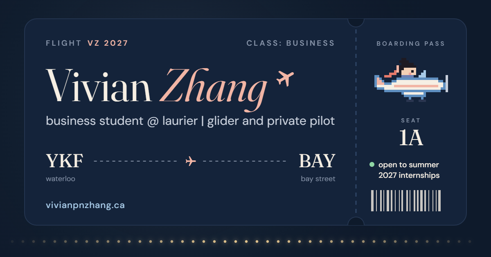

I got my glider licence before my driver's licence, and my private pilot licence a year later. Now that I'm in my first year of business school, I keep noticing the same ideas showing up in both places.

## 1. Always run the checklist

Every flight starts with a checklist, even on the hundredth flight. **Skipping a step because you "know it" is how mistakes happen.** Good businesses work the same way: clear processes free your attention for the things that actually need judgment. I saw this during my co-op too. Once we wrote down how tasks should be done through SOPs, fewer things got missed.

## 2. Plan the flight, then fly the plane

You plan the route, the fuel and the weather before you leave the ground. But once you're in the air, the wind is never exactly what the forecast said.

> A plan is a starting point, not a promise.

The skill is noticing early when things drift, and correcting a little at a time instead of all at once. Small changes are easier to manage than one big panic later, whether you’re flying or running a project.

## 3. Communicate clearly and briefly
On the radio, every word counts. Say who you are, where you are and what you want. It’s the best training I’ve had for emails, meetings and presentations. If I can’t say it in a few words, it usually means I haven’t figured out what I’m trying to say yet.

I didn’t expect flying and business school to have so much in common, but they keep teaching me the same lessons. Be prepared, stay flexible when things change, and say what you mean. I’m still early in both, so I’m sure there’s a lot more to learn. But for now, these three ideas are the ones I keep coming back to.

---

More soon. Thanks for reading! ✈
